##  &nbsp;À propos

 &nbsp;Je développe des jeux et des scripts **FiveM**, **Unity** et **Roblox** 
 &nbsp;En ce moment je bosse sur un **tycoon de boîte de nuit** sous Unity 
 &nbsp;J'apprends le **Rust** 
 &nbsp;Setup : **Arch Linux** + **VSCode**

##  &nbsp;Langages

<table>
  <tr>
    <td align="center" width="90"> <b>C#</b></td>
    <td align="center" width="90"> <b>Lua</b></td>
    <td align="center" width="90"> <b>C</b></td>
    <td align="center" width="90"> <b>Rust</b></td>
    <td align="center" width="90"> <b>Python</b></td>
    <td align="center" width="90"> <b>JavaScript</b></td>
    <td align="center" width="90"> <b>HTML</b></td>
    <td align="center" width="90"> <b>CSS</b></td>
  </tr>
</table>

##  &nbsp;Moteurs & outils

<table>
  <tr>
    <td align="center" width="90"> <b>Unity</b></td>
    <td align="center" width="90"> <b>Roblox Studio</b></td>
    <td align="center" width="90"> <b>FiveM</b></td>
    <td align="center" width="90"> <b>Blender</b></td>
    <td align="center" width="90"> <b>Git</b></td>
    <td align="center" width="90"> <b>VSCode</b></td>
    <td align="center" width="90"> <b>Arch Linux</b></td>
  </tr>
</table>

##  &nbsp;Projets

| | Projet | Description | Stack |
|:-:|---|---|---|
|  | [**FiveM Scripts Jobs**](https://github.com/LKTbgoodall/FiveM_Scripts_Jobs) | Scripts de métiers pour serveur FiveM |  |
|  | [**Discord Bot ETI**](https://github.com/LKTbgoodall/Discord_bot_ETI) | Bot Discord pour le référencement ETI (FiveM) |  |
|  | [**PokeRogue Extension**](https://github.com/LKTbgoodall/PokeRogue_Extension) | Extension navigateur pour PokeRogue |  |
|  | [**Portfolio**](https://github.com/LKTbgoodall/portfolio) | Mon portfolio |  |

##  &nbsp;Stats

<!-- Générées par .github/workflows/stats.yml sur la branche "stats" -->

##  &nbsp;Mes contributions se font manger

<!-- Généré par .github/workflows/snake.yml -->
<picture>
  <source media="(prefers-color-scheme: dark)" srcset="https://raw.githubusercontent.com/LKTbgoodall/LKTbgoodall/output/snake.svg" />
  <source media="(prefers-color-scheme: light)" srcset="https://raw.githubusercontent.com/LKTbgoodall/LKTbgoodall/output/snake-light.svg" />
  
</picture>
