##  &nbsp;À propos

 &nbsp;Je développe des jeux et des scripts **FiveM**, **Unity** et **Roblox** 
 &nbsp;En ce moment je bosse sur un **tycoon de boîte de nuit** sous Unity 
 &nbsp;J'apprends le **Rust** 
 &nbsp;Setup : **Arch Linux** + **VSCode**

##  &nbsp;Langages

##  &nbsp;Moteurs & outils

##  &nbsp;Projets

<!-- Blocs générés par .github/scripts/blocks.py -->

##  &nbsp;Stats

<!-- Générée par .github/workflows/stats.yml sur la branche "stats" -->

##  &nbsp;Contributions

<!-- Généré par .github/workflows/stats.yml sur la branche "stats" -->

